# MindWell

**A safety-first, privacy-preserving AI companion for student mental wellbeing — with consent-scoped emergency support.**

MindWell is a full-stack web platform for college students. It combines a Gemini-powered conversational
companion, daily self check-ins, short guided activities and a gentle reward system — and it is designed so that
the most important behaviours (crisis handling, failure reporting, privacy of class analytics, emergency messages)
are decided by auditable code, not by the language model.

> **Not a medical service.** MindWell is a wellbeing companion and research project, not a therapist, diagnostic tool or
> emergency service. If you or someone else is in danger in India, call **112**. For free 24×7 mental-health support
> call **Tele-MANAS 14416** or **1800-891-4416**. MindWell is not affiliated with Tele-MANAS or the Government of India.

<p align="center">
  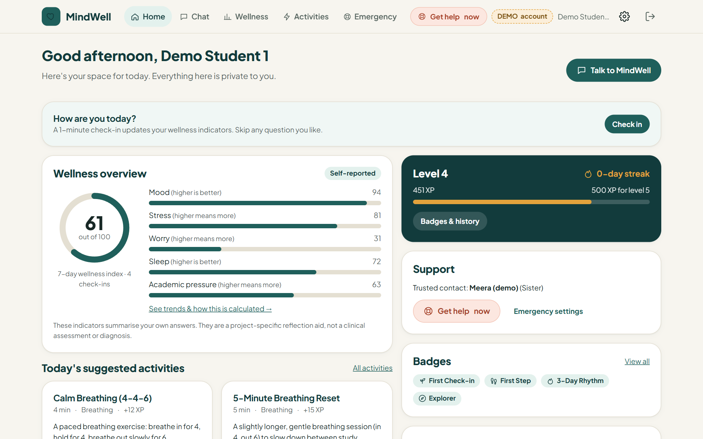
</p>

---

## Contents

[Overview](#overview) · [Features](#key-features) · [Screenshots](#screenshots) · [Architecture](#architecture) ·
[Tech stack](#technology-stack) · [Structure](#project-structure) · [Getting started](#getting-started) ·
[Usage](#usage-guide) · [Modules](#important-modules) ·
[Testing](#testing-and-evaluation) · [Limitations](#limitations-and-future-work) · [Author](#author) · [License](#license)

## Overview

### The problem

Roughly a third of first-year university students screen positive for a common mental disorder, and many never reach
professional care. LLM chatbots offer a low-barrier first step, but putting one in front of students raises concrete
risks: unsafe replies during a crisis, silent AI failures dressed up as answers, teacher dashboards that drift into
surveillance of individuals, and "emergency" buttons that claim a message was delivered when it was only queued.

### Objectives

1. Offer supportive, non-judgemental conversation and small, practical wellbeing activities.
2. Respond to crisis language **without depending on the LLM**, with helplines one tap away on every screen.
3. Never fabricate AI output or overstate what the system did.
4. Give teachers useful class-level trends **without** any way to see or identify an individual student.
5. Let students reach a trusted contact, sharing only what they explicitly approve.

## Key features

| Area | What it does |
|---|---|
| **AI companion** | Gemini chat with structured JSON output validated on the server; replies labelled by source; honest "no reply was generated" state on failure |
| **Layered safety** | Deterministic phrase screen (English + romanized Hindi) runs *before* the model; crisis → fixed, human-written message + support panel; model risk flag can only escalate |
| **Conversation memory** | Bounded context (≤12 messages), student-written notes and labelled AI summaries; view, delete or turn off anytime |
| **Wellness indicators** | Optional daily check-in → documented, non-clinical indicators (mood, stress, worry, sleep, academic pressure, wellness index), trends, corrections |
| **Activities** | 10 built-in interactive activities (paced breathing, grounding, journaling, gratitude, study break, walk, sleep reflection, muscle relaxation, planning) + AI-generated personal activities checked against unsafe-content rules |
| **Rewards** | Server-side XP ledger, levels, streaks and 8 badges; idempotent awards, daily caps, nothing ever taken away |
| **Teacher analytics** | Opt-in, per-student-averaged weekly class aggregates, suppressed below 5 contributors; rule-based observations + separately labelled AI insight |
| **Emergency support** | Trusted-contact `tel:` calling, Tele-MANAS and 112 links, consent-scoped messages via SMTP / Twilio with preview → confirm and truthful delivery status |
| **Security & privacy** | scrypt passwords, HttpOnly session cookies, CSRF tokens, rate limiting, ownership checks on every endpoint, consent records, data export, cascading account deletion, retention purge |

## Screenshots

All screenshots are from the running application using **synthetic demo accounts**.

| Student dashboard | Wellness indicators |
|---|---|
|  | 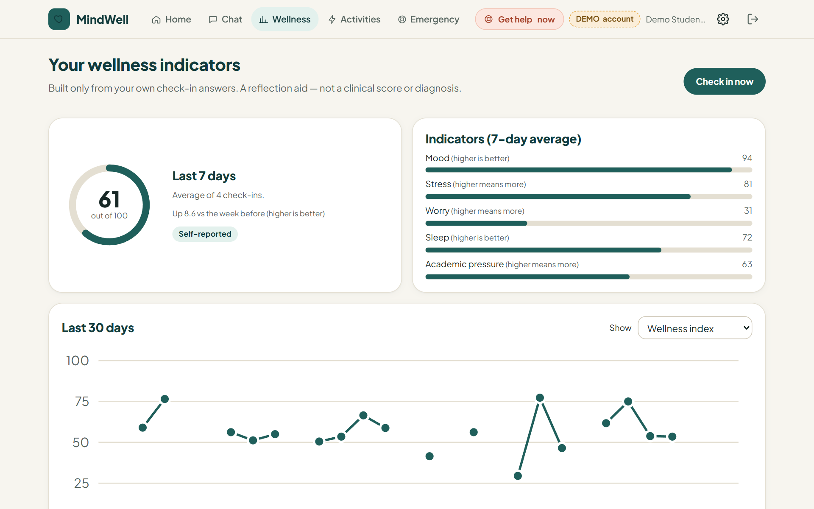 |
| **Crisis response — pre-written, not AI-generated** | **Support panel (one tap from every screen)** |
| 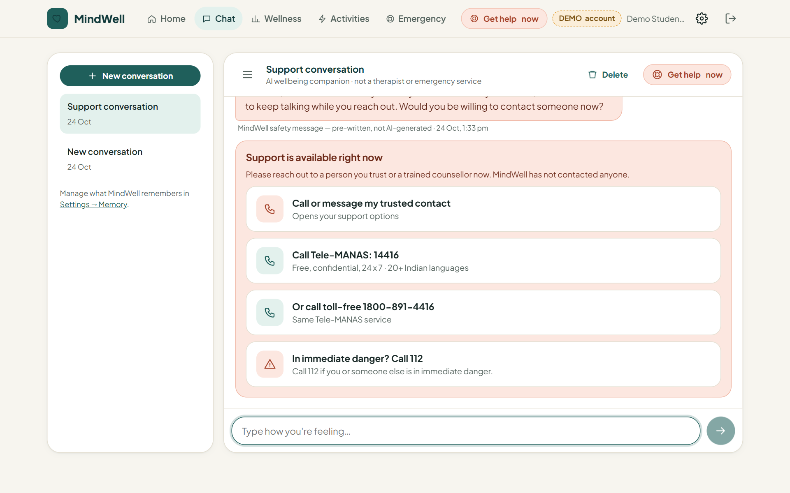 | 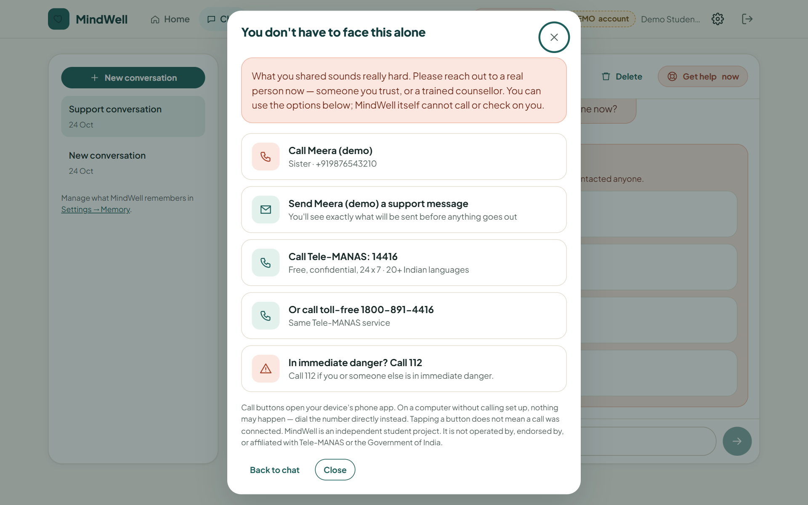 |
| **Guided breathing activity** | **Progress, badges and XP** |
| 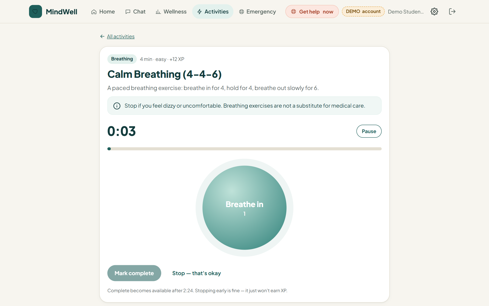 | 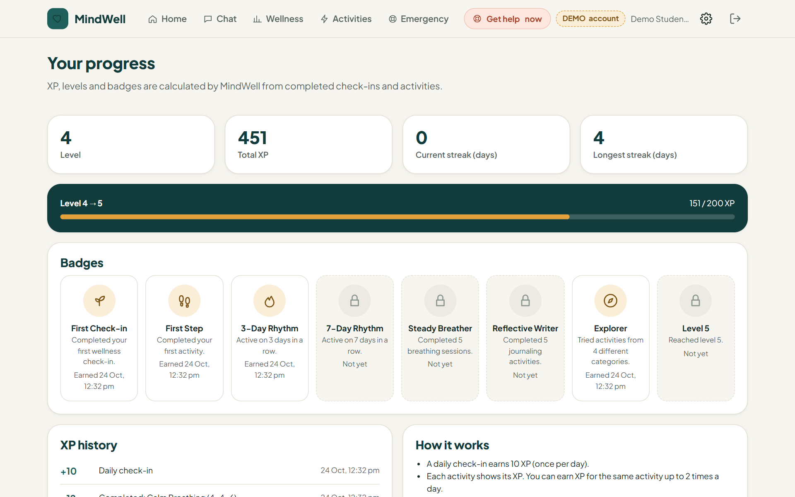 |
| **Emergency settings** | **Teacher view — aggregate only** |
| 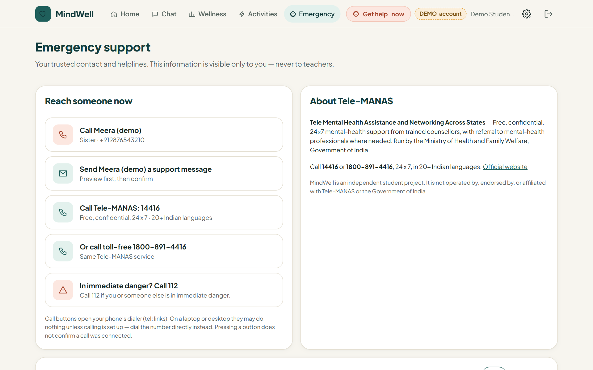 | 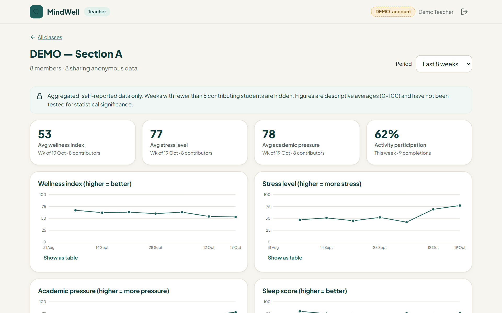 |
| **Recorded observations vs. labelled AI insight** | **Honest failure when the AI provider is unavailable** |
| 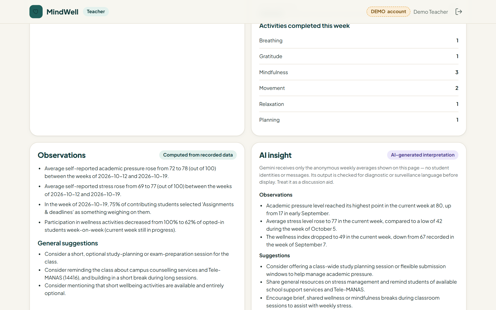 | 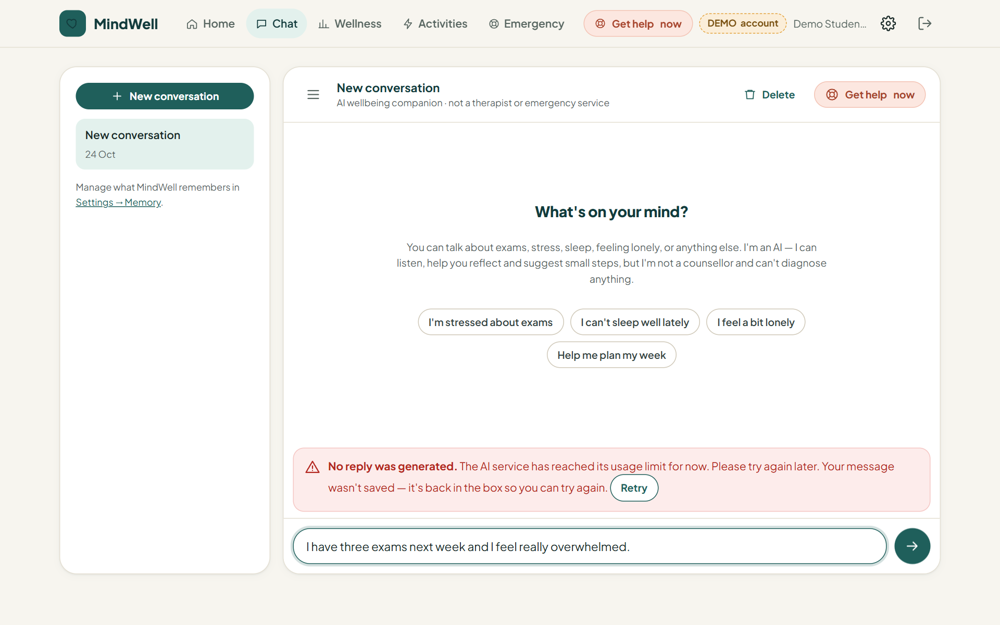 |

<p align="center">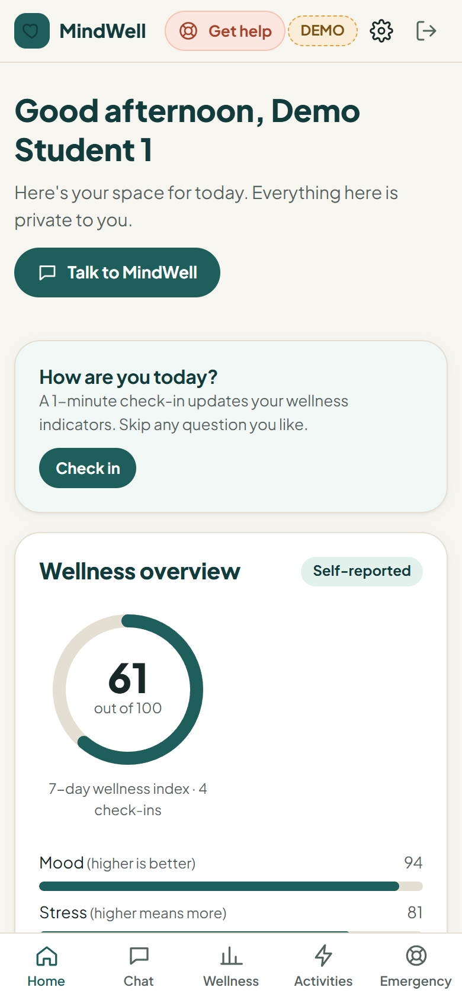<br><em>Responsive layout (390 px)</em></p>

## Architecture

<p align="center">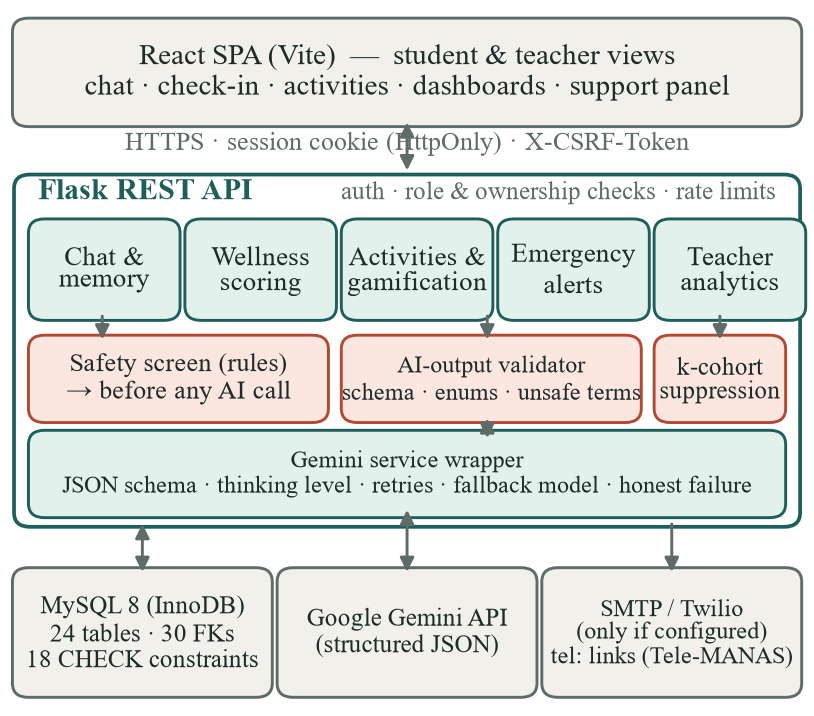</p>

Every chat message follows the pipeline below. The rule screen gives a guarantee that does not depend on a remote
service; the model adds recall for indirect language; the merge `level = max(rule, AI)` can escalate but never downgrade.
No step ever contacts anyone automatically.

<p align="center">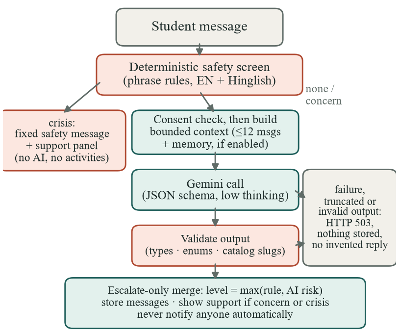</p>

## Technology stack

| Layer | Technologies |
|---|---|
| Frontend | React 18, React Router 6, Vite 6, plain CSS design system (no UI framework) |
| Backend | Python 3.12, Flask 3, Flask-SQLAlchemy / SQLAlchemy 2.1, Flask-Limiter, Waitress |
| Database | MySQL 8 (InnoDB, PyMySQL); SQLite in-memory for tests |
| AI | Google Gemini via the official `google-genai` SDK — `gemini-3.8-flash` with `gemini-3.5-flash` fallback (configurable) |
| Notifications | SMTP e-mail, Twilio SMS (optional, credential-gated) |
| Testing | pytest (83 tests), scripted end-to-end checks, Playwright headless-browser walkthrough |

## Project structure

```
MindWell_Prototype/
├── backend/
│   ├── app/
│   │   ├── routes/            # auth, profile, chat, wellness, activities, emergency, teacher, public
│   │   ├── services/          # gemini, prompts, ai_validation, safety, memory, scoring, gamification,
│   │   │                      # recommendations, notifications, analytics
│   │   ├── models.py          # 24-table relational schema
│   │   ├── security.py        # sessions, role decorators, CSRF
│   │   └── cli.py             # init-db, create-teacher, seed-demo, remove-demo, purge-expired, export-schema
│   ├── tests/                 # 83 pytest tests (Gemini mocked)
│   ├── requirements.txt
│   └── wsgi.py
├── frontend/                  # React app (src/pages, src/components, src/lib, src/styles)
├── shared/support-config.json # Tele-MANAS / 112 numbers — single source for backend and frontend
├── database/schema.sql        # generated MySQL DDL
├── docs/                      # API, database, scoring, gamification, security & privacy, status
├── assets/                    # screenshots and diagrams used in this README
├── prototype/                 # original static HTML mock-ups (reference only)
└── .env.example
```

## Getting started

### Prerequisites

| Software | Version | Notes |
|---|---|---|
| Python | 3.10+ (tested 3.12.10) | |
| Node.js | 18.18+ (tested 22 LTS) | <https://nodejs.org> |
| MySQL Server | 8.0+ (tested 8.0.46) | Windows service `MySQL80` |
| Gemini API key | — | <https://aistudio.google.com/apikey> (needed only for AI features) |

### 1. Configure

```powershell
git clone https://github.com/vaibhav-pyy/MindWell.git
cd MindWell
copy .env.example .env            # macOS/Linux: cp .env.example .env
python -c "import secrets; print(secrets.token_urlsafe(48))"    # paste the output as SECRET_KEY
```

Edit `.env` and set `SECRET_KEY`, `MYSQL_USER`, `MYSQL_PASSWORD` and `GEMINI_API_KEY`. Quote passwords that contain `#`
or spaces. A dedicated MySQL user is recommended:

```sql
CREATE USER 'mindwell'@'localhost' IDENTIFIED BY 'choose-a-strong-password';
GRANT ALL PRIVILEGES ON mindwell.* TO 'mindwell'@'localhost';
```

### 2. Backend

```powershell
cd backend
python -m venv .venv
.venv\Scripts\activate                       # macOS/Linux: source .venv/bin/activate
pip install -r requirements-dev.txt
python -m flask --app wsgi init-db           # creates the database, 24 tables, activities and badges
python -m flask --app wsgi create-teacher --email teacher@college.edu --name "Teacher Name"
python -m flask --app wsgi run --port 5000
```

### 3. Frontend (second terminal)

```powershell
cd frontend
npm install
npm run dev                                  # http://localhost:5173 (proxies /api to port 5000)
```

### 4. Optional demo data

```powershell
cd backend
python -m flask --app wsgi seed-demo         # synthetic class: 1 teacher, 8 students, 6 weeks of data
python -m flask --app wsgi remove-demo       # deletes every demo account
```

Demo accounts use `@demo.mindwell.local`, show a **DEMO** badge, and receive random one-time passwords printed only
to your terminal. `seed-demo` refuses to run when `APP_ENV=production`.

### Configuration reference

| Variable | Required | Purpose |
|---|---|---|
| `SECRET_KEY` | yes | Signs session cookies |
| `MYSQL_*` or `DATABASE_URL` | yes | Database connection |
| `GEMINI_API_KEY` | for AI features | Chat, AI activities, memory summaries, teacher insights |
| `GEMINI_MODEL`, `GEMINI_FALLBACK_MODEL`, `GEMINI_THINKING_LEVEL` | no | Model selection and reliability |
| `NOTIFY_PROVIDER_EMAIL=smtp` + `SMTP_*` | for e-mail alerts | Real e-mail delivery of emergency messages |
| `NOTIFY_PROVIDER_SMS=twilio` + `TWILIO_*` | for SMS alerts | Real SMS delivery |
| `MIN_COHORT_SIZE` | no | Teacher privacy threshold (default 5, minimum 3) |

See [.env.example](.env.example) for every option. Without a Gemini key or notification provider the app still runs and
clearly reports those features as unavailable.

## Usage guide

**Students** — register at `/register` (AI processing is a separate, optional consent), then:
- **Check in** daily (every question is optional) and see indicators and trends under *Wellness*.
- **Chat** with the companion — e.g. *"I have three exams next week and feel overwhelmed"* — and start any suggested activity.
- **Do an activity** — e.g. *Calm Breathing (4-4-6)*; completion is timed by the server and earns XP.
- **Add a trusted contact** under *Emergency*; optionally allow support messages and choose exactly what they include.
- Press **Get help now** from any screen for the trusted-contact call, Tele-MANAS and 112.
- Manage memory, privacy, classes, journal, data export or account deletion under *Settings*.

**Teachers** — accounts are created with `flask create-teacher`. Create a class, share its join code, and view weekly
aggregates once at least five opted-in students contribute. *Generate AI insight* sends only those aggregates to Gemini.

## Important modules

| Module | Responsibility |
|---|---|
| [`services/safety.py`](backend/app/services/safety.py) | Deterministic crisis/concern screen; escalate-only merge; fixed safety message |
| [`services/gemini.py`](backend/app/services/gemini.py) | Single wrapper for all model calls: JSON schema, thinking level, retries, fallback, typed failures |
| [`services/ai_validation.py`](backend/app/services/ai_validation.py) | Validates every model output; unsafe-content and diagnostic-language filters |
| [`services/memory.py`](backend/app/services/memory.py) | Bounded, student-scoped context and labelled conversation summaries |
| [`services/scoring.py`](backend/app/services/scoring.py) | Wellness indicator model (documented in [docs/WELLNESS_SCORING.md](docs/WELLNESS_SCORING.md)) |
| [`services/gamification.py`](backend/app/services/gamification.py) | XP ledger, levels, streaks, badges |
| [`services/analytics.py`](backend/app/services/analytics.py) | Opt-in aggregation, per-student averaging, k-cohort suppression |
| [`services/notifications.py`](backend/app/services/notifications.py) | Consent-scoped message composition, SMTP/Twilio delivery, truthful statuses |

Further documentation: [API reference](docs/API.md) · [Database design](docs/DATABASE.md) ·
[Gamification rules](docs/GAMIFICATION.md) · [Security & privacy](docs/SECURITY_PRIVACY.md) · [Project status](docs/STATUS.md)

## Testing and evaluation

```powershell
cd backend
python -m pytest -q            # 83 tests, ~20 s; in-memory SQLite and a scripted fake Gemini — no credentials needed
```

| Evaluation (technical, not clinical) | Result |
|---|---|
| Automated test suite | 83 / 83 passing |
| End-to-end checks on MySQL 8.0.46 + live Gemini API | 36 / 36 passing |
| Headless-browser walkthrough (desktop + 390 px mobile) | 28 page views, no errors or overflow |
| Rule safety screen, author-constructed set (n = 40) | 16/16 explicit crisis detected; 0/4 indirect; 0 false alarms on hyperbole; 3 false alarms on topic/third-party mentions |
| Gemini structured output, default vs. capped reasoning | truncated replies 3/8 → 0/6; median latency 5.7 s → 2.5 s |

No user study or clinical validation has been carried out.

## Limitations and future work

- No user study yet; indicators are a project-specific reflection aid, **not** clinically validated.
- The safety screen catches explicit phrasing but misses indirect language; the AI layer adds recall but cannot catch every crisis.
- Class aggregates use threshold suppression, not differential privacy.
- E-mail/SMS delivery is implemented but untested with real provider accounts; the UI is English-only.
- Conversation text is processed by Google's Gemini API when AI processing is enabled.

Planned: an ethics-approved pilot with students and counsellors, clinician review of safety responses, multilingual and
code-mixed evaluation sets (Hindi, Kannada), differentially private class statistics, and an on-premises open-model option.

## Author

Built by **Vaibhav R.** ([@vaibhav-pyy](https://github.com/vaibhav-pyy)) — Department of Artificial Intelligence and Machine
Learning, New Horizon College of Engineering, Bengaluru, India.

Co-author: **Shonika K.** ([@shonika09](https://github.com/shonika09))

### Acknowledgments

Helpline information is based on the Government of India's Tele-MANAS programme. The original static HTML mock-ups
in [`prototype/`](prototype/) informed the visual design.

## License

Released under the [MIT License](LICENSE).
